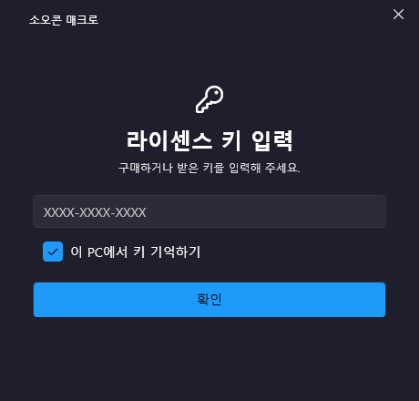
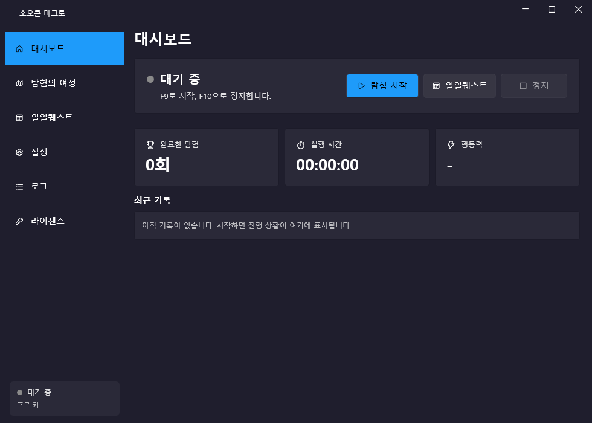
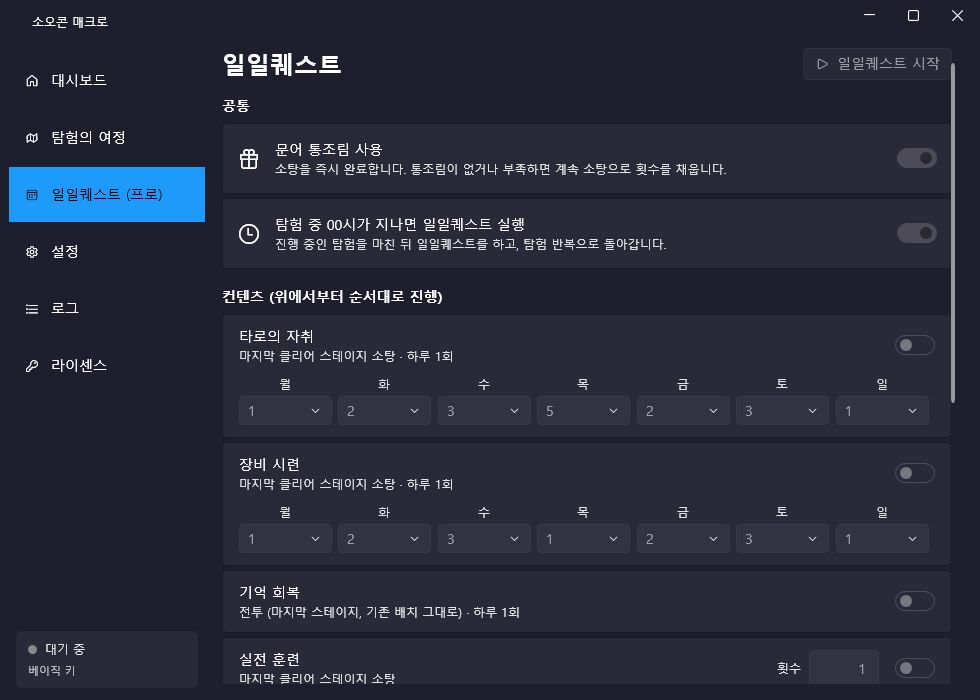
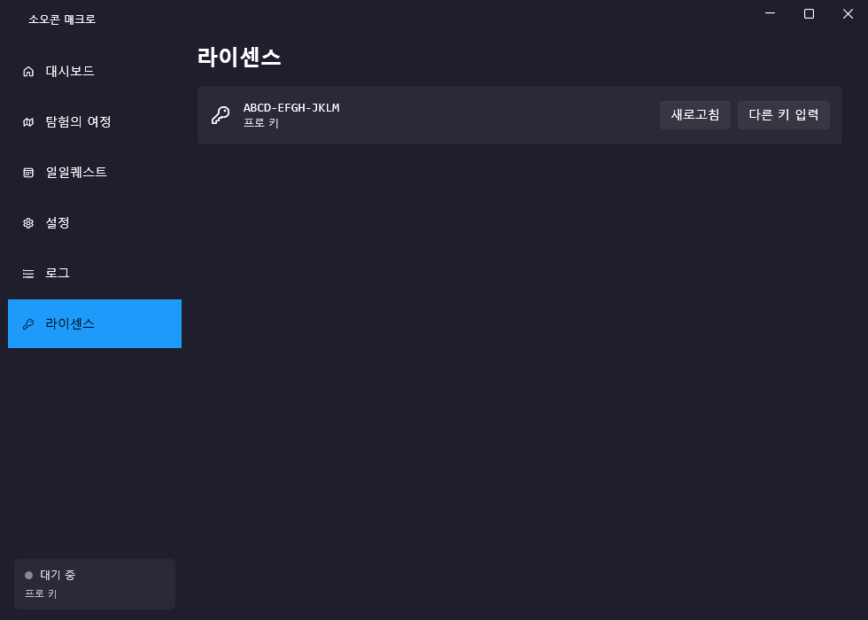
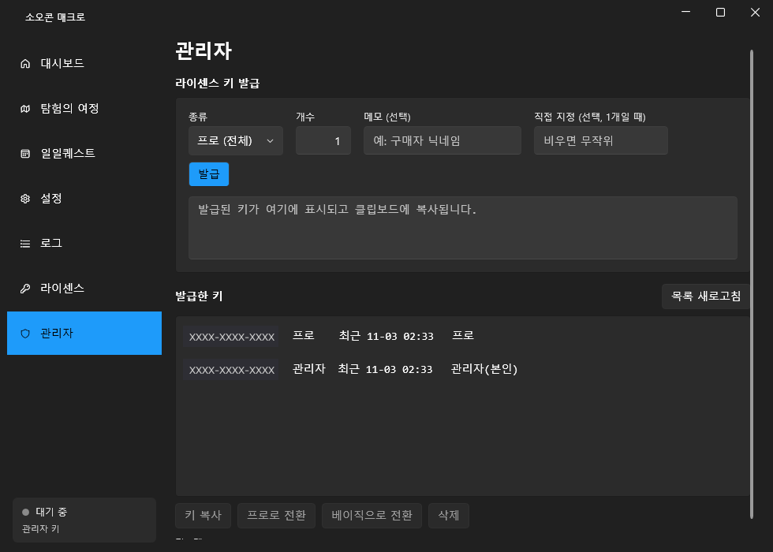

# 라이센스 키 시스템 구현 가이드 (Firebase, 서버 함수 없음, 무료)

> 이 문서를 그대로 AI(Claude 등)에게 주고 "이 설계대로 구현해 줘"라고 하면 됩니다.
> 참고 구현: 소오콘 매크로(WPF, .NET 9). 다른 언어/프레임워크에도 같은 구조로 적용 가능.

---

## 1. 요구사항 (최종 확정본)

- **키 하나만 입력하면 통과.** 비밀번호·이메일·회원가입 없음. 키 = 계정.
- **기간 제한 없음.** 서버에 키가 있으면 사용 가능, 서버에서 키를 삭제하면 다음 확인부터 차단.
- **PC 제한 없음** (한 키를 여러 PC에서 사용 가능). 필요하면 9장의 확장 참고.
- **키 종류(tier)**: `basic`(일부 기능), `pro`(전체 기능), 그리고 **관리자 키**(`admin: true`, pro 포함 + 관리자 페이지).
- **관리자 페이지는 관리자 키로 로그인했을 때만 보임.**
- **관리자 기능**: 키 발급(종류/개수/메모/직접 지정, 클립보드 자동 복사), 키 목록(최근 사용 시각), 종류 변경, 삭제.
- **"이 PC에서 키 기억하기"**: 다음 실행부터 자동 확인.
- **매크로(핵심 기능) 시작할 때마다 서버에서 다시 확인.**
- **카드 등록 없이 무료** → Cloud Functions(유료 Blaze 요금제 필요) 대신 **Firestore 보안 규칙만으로** 보호.

---

## 2. 전체 구조

```
[앱]  ── 키로 문서 하나 조회 (GET ids/{key}?key=웹API키) ──▶ [Firestore]
      ── "최근 사용" 시각만 서버시간으로 기록 (commit) ───▶   보안 규칙이 그 외 전부 거부
[관리자 PC] ── 프로젝트 소유자 Google 토큰(Firebase CLI 로그인) ──▶ 규칙을 우회하는 관리자 권한
```

- **보안의 핵심은 서버 규칙.** 앱 코드는 디컴파일로 우회될 수 있으므로, "키 목록 보기 / 종류 바꾸기 / 관리자 지정 / 가짜 키 만들기"는 서버가 막아야 함.
- **키를 아는 것 자체가 인증.** 그래서 키는 무작위로 만들고, 목록 조회(list)는 막는다.
- **관리자 작업은 앱의 일반 권한이 아니라 프로젝트 소유자 Google 자격증명**으로 한다. 소유자 OAuth 토큰으로 Firestore REST를 호출하면 보안 규칙을 우회한다. 관리자 PC에서 `firebase login`(소유자 계정)만 되어 있으면 됨.

---

## 3. Firestore 데이터

컬렉션 `ids`, 문서 ID = 라이센스 키 (예: `K7QM-4XPA-9TRD`)

| 필드 | 타입 | 설명 |
|---|---|---|
| `tier` | string | `"basic"` 또는 `"pro"` |
| `admin` | bool | 관리자 키면 `true` (없으면 false 취급) |
| `note` | string | 메모 (구매자 닉네임 등) |
| `createdAt` | timestamp | 발급 시각 (서버 시간) |
| `lastSeen` | timestamp | 최근 사용 시각 (서버 시간, 앱이 기록) |

---

## 4. 보안 규칙 (`firestore.rules`) — 그대로 사용

```
rules_version = '2';
service cloud.firestore {
  match /databases/{db}/documents {
    match /ids/{key} {
      allow get: if true;                       // 키를 아는 사람만 그 문서 하나 조회
      allow list, create, delete: if false;     // 목록·생성·삭제 금지 (관리자는 소유자 토큰으로 우회)
      // 앱은 "최근 사용" 시각만 서버 시간으로 찍을 수 있음
      allow update: if request.resource.data.diff(resource.data).affectedKeys().hasOnly(['lastSeen'])
        && request.resource.data.lastSeen == request.time;
    }
  }
}
```

배포: 규칙 파일이 있는 폴더에 아래 두 파일을 두고 `firebase deploy --only firestore:rules`

`firebase.json`
```json
{ "firestore": { "rules": "firestore.rules" } }
```
`.firebaserc`
```json
{ "projects": { "default": "<프로젝트ID>" } }
```

**반드시 테스트할 것** (웹 API 키만으로, 즉 일반 사용자 입장에서): 아래가 전부 403이어야 정상.
- `GET .../documents/ids?key=...` (목록) → 403
- `tier`를 pro로 바꾸는 commit → 403
- `admin: true` 설정 commit → 403
- 없는 키를 새로 만드는 commit → 403
- `lastSeen`만 `REQUEST_TIME`으로 바꾸는 commit → 200 (허용)

---

## 5. Firebase 프로젝트 준비 (회사 PC에서 처음부터)

1. Node.js 설치 → `npm i -g firebase-tools` → `firebase login` (프로젝트 소유자가 될 Google 계정)
2. 프로젝트 생성: `firebase projects:create <고유ID> --display-name "<이름>"`
3. 웹 앱 등록: `firebase apps:create WEB <앱이름> --project <ID>` → `firebase apps:sdkconfig WEB <앱ID>` 로 **apiKey** 확인
   - 이 apiKey는 공개용이라 앱에 넣어도 됨 (접근 통제는 보안 규칙이 함).
4. Firestore API 켜기 (처음엔 꺼져 있어서 DB 생성이 403으로 실패함):
   - 소유자 토큰으로 `POST https://serviceusage.googleapis.com/v1/projects/<ID>/services:batchEnable`
     body `{"serviceIds":["firestore.googleapis.com","firebaserules.googleapis.com"]}`
   - 또는 콘솔에서 Firestore 메뉴 들어가면 자동으로 켜짐
5. DB 생성: `firebase firestore:databases:create "(default)" --location asia-northeast3 --project <ID>` (서울)
6. 규칙 배포 (4장)
7. **첫 관리자 키 생성** (앱의 관리자 페이지는 관리자 키로 로그인해야 열리므로, 첫 키는 직접 만든다):
   - 소유자 토큰으로 `POST https://firestore.googleapis.com/v1/projects/<ID>/databases/(default)/documents:commit`
   ```json
   {"writes":[{"update":{"name":"projects/<ID>/databases/(default)/documents/ids/<관리자키>",
     "fields":{"tier":{"stringValue":"pro"},"admin":{"booleanValue":true},
               "note":{"stringValue":"관리자"},"lastSeen":{"nullValue":null}}},
     "currentDocument":{"exists":false},
     "updateTransforms":[{"fieldPath":"createdAt","setToServerValue":"REQUEST_TIME"}]}]}
   ```
   - 헤더: `Authorization: Bearer <소유자 access token>`, `X-Goog-User-Project: <ID>`
   - 또는 Firebase 콘솔 > Firestore > 데이터에서 문서를 직접 추가해도 됨

**소유자 토큰 얻는 법**: firebase CLI 로그인 정보 파일
`%USERPROFILE%\.config\configstore\firebase-tools.json` 의 `tokens.access_token` (만료 시각 `tokens.expires_at`, ms).
만료됐으면 아무 CLI 명령(`firebase projects:list --json`)을 한 번 실행하면 갱신된다.

---

## 6. 앱 쪽 구현

### 6-1. 키 확인 (일반 사용자, 인증 없음)

```
GET https://firestore.googleapis.com/v1/projects/<ID>/databases/(default)/documents/ids/<키>?key=<웹API키>
 - 404 → "등록되지 않은 라이센스 키입니다"
 - 200 → fields.tier / fields.admin 읽기
그 다음 최근 사용 기록 (실패해도 로그인은 막지 않음):
POST .../documents:commit?key=<웹API키>
{"writes":[{"update":{"name":"projects/<ID>/databases/(default)/documents/ids/<키>","fields":{}},
  "updateMask":{"fieldPaths":[]},"currentDocument":{"exists":true},
  "updateTransforms":[{"fieldPath":"lastSeen","setToServerValue":"REQUEST_TIME"}]}]}
```

판정: `admin == true` → 관리자(+pro), 아니면 `tier == "pro"` → 프로, 그 외 → 베이직.

### 6-2. 키 입력 정규화 (중요)

대소문자·공백·대시를 무시하고, 12자리 영문/숫자면 `XXXX-XXXX-XXXX` 형태로 맞춘다.
`7771 7771 7771`, `777177717771`, `7771-7771-7771` 이 모두 같은 키가 되어야 한다.

```csharp
public static string NormalizeKey(string key)
{
    string raw = new string(key.ToUpperInvariant().Where(c => c is not (' ' or '-' or '\t')).ToArray());
    if (raw.Length == 12 && raw.All(char.IsAsciiLetterOrDigit))
        return $"{raw[..4]}-{raw[4..8]}-{raw[8..]}";
    return raw.Replace("/", "");
}
```
(주의: 처음엔 무작위 키 알파벳에 있는 글자일 때만 대시를 붙였는데, `1`이 들어간 직접 지정 키가 대시 없이 입력되면 인식 못 하는 버그가 있었음.)

### 6-3. 무작위 키 생성

- 형식 `XXXX-XXXX-XXXX`, 글자 `23456789ABCDEFGHJKLMNPQRSTUVWXYZ` (헷갈리는 0/O, 1/I 제외, 32글자)
- 암호학적 난수(`RandomNumberGenerator.GetInt32`) 사용. 32^12 ≈ 1.15×10^18 가지라 추측 불가.
- 생성 시 `currentDocument.exists=false`로 커밋 → 이미 있는 키면 실패 처리.

### 6-4. 키 기억하기

- Windows DPAPI(`ProtectedData.Protect`, `DataProtectionScope.CurrentUser`)로 암호화해서
  `%AppData%\<앱이름>\license.bin`에 저장. NuGet: `System.Security.Cryptography.ProtectedData`
- 시작 시 저장된 키가 있으면 자동 확인. 확인 실패(키 삭제됨 등)하면 저장된 키를 지운다.

### 6-5. 화면 흐름

> 아래 화면은 참고 구현(소오콘 매크로, WPF + WPF-UI 다크 테마)의 실제 화면입니다. 키는 가려 두었습니다.

**① 앱 시작 → 키 입력 창**
키 입력칸, "이 PC에서 키 기억하기" 체크, [확인], 아래에 빨간 오류 메시지. 저장된 키가 있으면 창이 뜨자마자 자동 확인.



**② 통과 → 메인 창**
왼쪽 아래 상태 칸에 "베이직 키 / 프로 키 / 관리자 키" 표시. 핵심 기능 시작 버튼을 누를 때마다 6-1을 다시 호출 (삭제된 키는 여기서 차단).



**③ 베이직 키 → 프로 전용 기능 잠금**
프로 전용 메뉴에 "(프로)" 표시, 해당 페이지는 회색으로 비활성화, 시작 버튼도 비활성화. 관리자 메뉴 없음.



**④ "라이센스" 페이지**
현재 키와 종류, [새로고침](서버에서 다시 확인), [다른 키 입력](저장된 키 삭제 후 키 입력 창으로 재시작).



**⑤ "관리자" 페이지 (관리자 키일 때만 메뉴가 보임)**
- 발급: 종류(베이직/프로) · 개수 · 메모 · 직접 지정(비우면 무작위, 1개일 때만) → [발급] → 아래 칸에 표시 + 클립보드 자동 복사
- 목록: 키 / 종류(관리자·프로·베이직) / 최근 사용 시각 / 메모, [목록 새로고침]
- 선택한 키: [키 복사] [프로로 전환] [베이직으로 전환] [삭제] (관리자 키는 변경·삭제 불가)



WPF 구현 팁: `App.xaml`에서 `StartupUri` 제거, `ShutdownMode="OnExplicitShutdown"`으로 두고
`OnStartup`에서 키 창을 `ShowDialog()` → 성공하면 메인 창을 만들고 `ShutdownMode = OnMainWindowClose`.

### 6-6. 관리자 기능 (소유자 토큰 사용)

모든 요청에 `Authorization: Bearer <소유자 토큰>`, `X-Goog-User-Project: <ID>` (웹 API 키 대신).
- 목록: `GET .../documents/ids?pageSize=300` (+`pageToken`으로 다음 페이지)
- 발급: 6-3 + 5장 7번과 같은 commit (tier, admin 없음, note, lastSeen null, createdAt 서버시간)
- 종류 변경: commit `update` + `updateMask: ["tier"]`
- 삭제: `DELETE .../documents/ids/<키>`
- 관리자 키는 앱에서 바꾸거나 삭제하지 못하게 막아 두기 (실수 방지). 관리자 키 교체는 5장 7번 방식으로 새로 만들고 예전 것 삭제.

---

## 7. 배포 시 보호 (.NET)

- 단일 exe + 자체 포함: `dotnet publish -c Release -r win-x64 --self-contained true -p:PublishSingleFile=true -p:IncludeNativeLibrariesForSelfExtract=true -p:EnableCompressionInSingleFile=true`
- 난독화: Obfuscar (`dotnet tool install Obfuscar.GlobalTool`, 로컬 매니페스트). `HideStrings=true`로 URL·API 키·문자열 암호화, `KeepPublicApi=true` + `HidePrivateApi=true` (WPF가 깨지지 않게 공개 이름 유지).
- 난독화는 csproj에 `AfterTargets="Build"` 타깃으로 넣어 **publish가 직접 빌드할 때 끼워 넣는다**.
  (`dotnet build` 후 난독화 → `publish --no-build` 방식은 자체 포함 런타임이 안 묶여서 실패함)
- 앱이 읽는 이미지 등 리소스는 `EmbeddedResource`로 넣어야 exe만 옮겨도 동작함.
- 한계: 난독화는 분석을 어렵게 할 뿐 완전 방지는 못 함. **진짜 방어선은 4장의 서버 규칙.**

---

## 8. 겪었던 함정 (시간 절약용)

| 증상 | 원인 / 해결 |
|---|---|
| 이메일 로그인 켜려고 API 호출 → `BILLING_NOT_ENABLED` | API로는 Identity Platform(유료)만 켜짐. 이 설계는 Auth를 아예 안 쓰므로 무관. (Auth가 필요하면 콘솔에서 직접 켜야 함) |
| Firestore DB 생성 403 | Firestore API가 꺼져 있음 → 5장 4번 |
| 커밋했는데 아무것도 안 바뀜 / 400 `integer_value` 오류 | JSON 필드 타입 실수. 숫자는 `{"integerValue":"7"}`(문자열), 불리언 `{"booleanValue":true}`, null은 `{"nullValue":null}` |
| PowerShell 5.1에서 `RandomNumberGenerator::GetInt32` 없음 | 키 생성 스크립트는 Python `secrets` 또는 .NET 앱에서 |
| 키 문서가 있는데 "등록되지 않은 키" | 입력 정규화(6-2) 불일치. 저장된 문서 ID와 같은 형태로 맞추기 |
| 관리자 메뉴가 일반 키로도 보임 | 메뉴 표시 조건을 "CLI 로그인 존재"가 아니라 "현재 키의 admin == true"로 |

---

## 9. 확장 아이디어 (지금은 미적용)

- **체험 기간**: 문서에 `firstUsed`(첫 사용 시 서버시간으로 1회만 기록 가능하게 규칙 작성) + `trialDays`. 앱이 `lastSeen`(서버시간)과 비교. PC 시계 조작 무력화.
- **1키 1PC**: 문서에 `deviceId`(Windows `MachineGuid`의 해시). 규칙으로 "비어 있을 때만 기록" 허용, 관리자가 초기화.
- **동시 사용 1대**: 실행 중 주기적으로 `lastSeen` + `sessionId` 갱신, 다른 세션이 최근 N분 내 활동 중이면 거부.
- 규칙에서 필드를 추가로 허용할 때는 항상 `affectedKeys().hasOnly([...])`로 바꿀 수 있는 필드를 최소한으로 제한하고, 시간 값은 `== request.time`으로 강제할 것.
